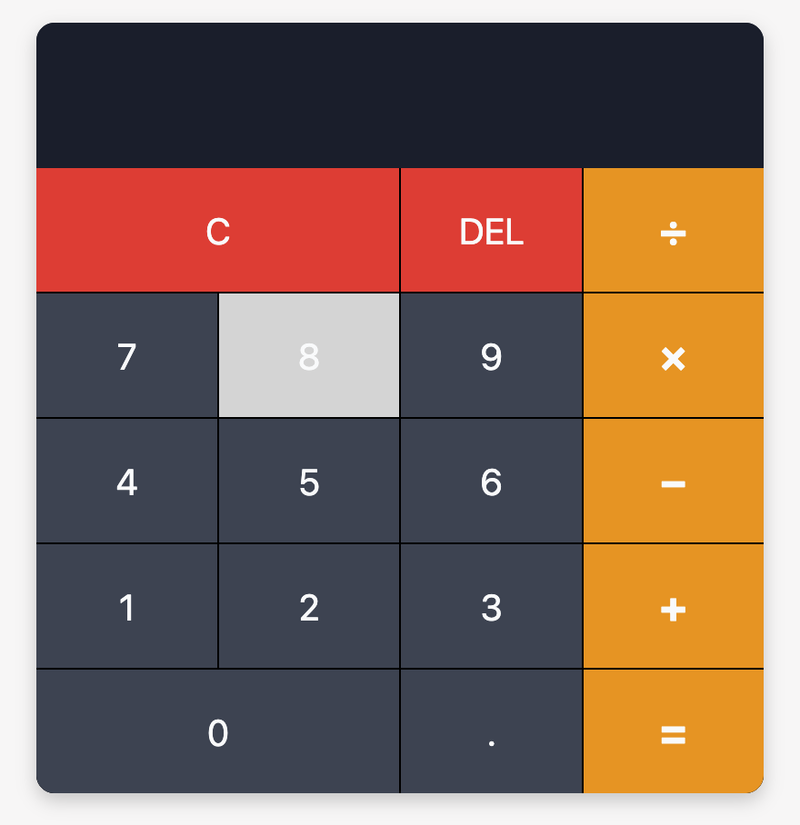

# Browser-Based Calculator

This project is Task 1 of Level 2 in the Web Development and Designing track for My Oasis Infobyte (OIBSIP) Internship. It is a fully functional, browser-based calculator built to handle basic arithmetic operations with a responsive and user-friendly interface.

## 🚀 Live Demo
*([https://oibsip-cyan.vercel.app/WebDev-L2-Calculator/index.html])*

## 🛠️ Tech Stack
* **HTML5:** Semantic structure using custom `data-` attributes for clean JavaScript integration.
* **CSS3:** Built with CSS Variables for easy theming and **CSS Grid** for precise button layout and alignment.
* **JavaScript (Vanilla):** Object-oriented approach using an ES6 Class to manage state without relying on the unsafe `eval()` function.

## ✨ Core Features
* **Operator Chaining:** Allows sequential operations (e.g., `5 + 3 × 2`) without requiring a full reset.
* **Division by Zero Protection:** Displays a clear `can't be divided by 0` message instead of crashing or returning `Infinity`.
* **Dual Display Screen:** Shows both the previous operand (with the chosen operator) and the current input, providing excellent user feedback.
* **Robust Input Handling:** Prevents multiple decimal points and safely handles backspace/delete operations.
* **Zero Inline JavaScript:** All event listeners are handled purely within `script.js`, maintaining a strict separation of concerns.

## 📂 File Structure
* `index.html` - The structural markup of the calculator.
* `style.css` - The design, utilizing CSS Grid and Flexbox.
* `script.js` - The logic and DOM manipulation.
* `image.png` - The visual image of the calculator
* `README.md` - Project documentation.

## 🧠 Architecture Notes
Instead of relying on basic global variables, the logic is encapsulated inside a `Calculator` class. This ensures the calculator's state (current operand, previous operand, and selected operation) is securely managed and updated via dedicated class methods like `compute()`, `appendNumber()`, and `updateDisplay()`.