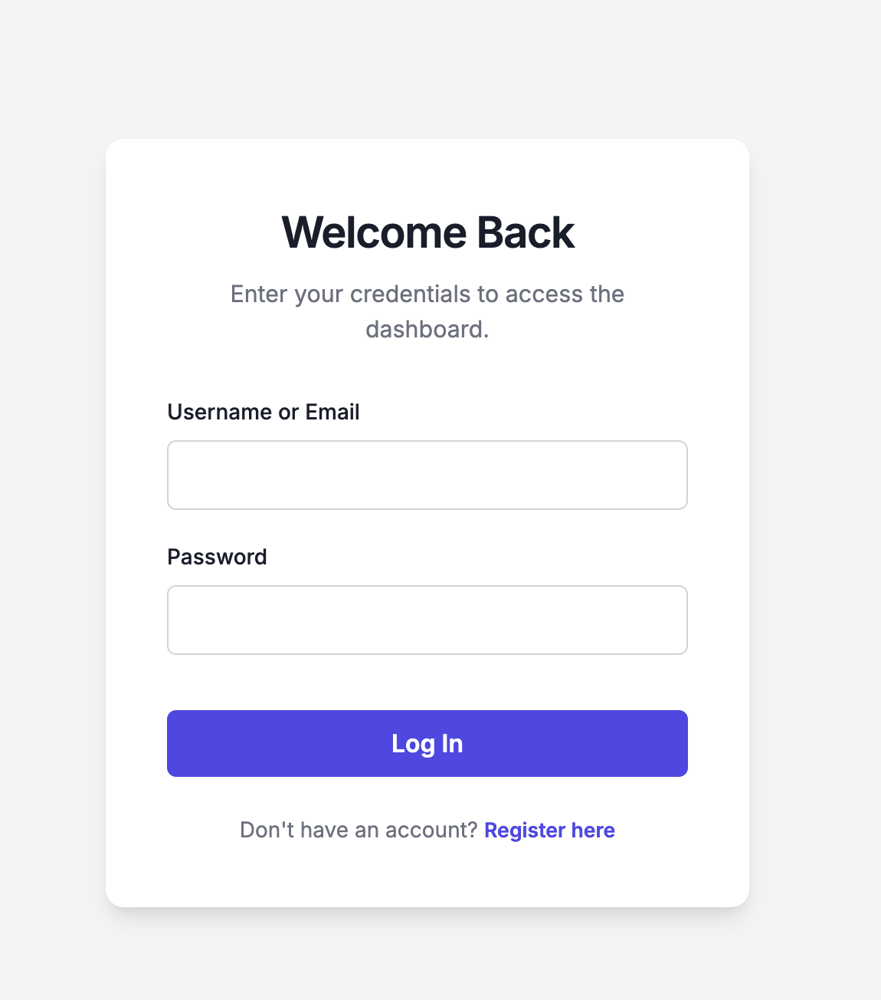

# 🔒 Secure Client-Side Authentication System

This project is Task 4 of Level 2 in the Web Development and Designing track for the Oasis Infobyte (OIBSIP) Internship. It is a front-end authentication portal that demonstrates modern security practices, state management, and route protection without relying on a backend server.

## 🚀 Live Demo
*([https://oibsip-cyan.vercel.app/WebDev-L2-LoginAuth/index.html])*

## 🛠️ Tech Stack & Architecture
* **HTML5:** Dual-page architecture (`index.html` for auth, `dashboard.html` for the protected route).
* **CSS3:** Clean, trust-inspiring UI with custom animations for Single Page Application (SPA) style form toggling.
* **JavaScript (Vanilla):** DOM manipulation, session state management via `localStorage`, and asynchronous cryptography.
* **Web Crypto API:** Native browser API utilized for secure password hashing.

## ✨ Core Security Features
* **SHA-256 Password Hashing:** Passwords are never stored in plain text. User inputs are cryptographically hashed before being saved to the local database, mimicking production-level backend security.
* **Protected Routing (Route Guard):** The dashboard page actively checks for a valid session token on load. Unauthorized users are forcefully redirected to the login screen before the UI even renders.
* **Anti-Enumeration Error Handling:** Login failures return a generic "Invalid username or password" message, preventing malicious actors from confirming if a specific email or username exists in the system.
* **Regex Validation:** Enforces strict password requirements (minimum 8 characters, at least 1 number) during registration.

## 📂 File Structure
* `index.html` - The login and registration portal.
* `dashboard.html` - The protected user environment.
* `style.css` - The design system and UI layout.
* `auth.js` - The cryptographic logic, form validation, and session routing.

## 👨‍💻 Developed By
**Solagbade Abdulmalik**