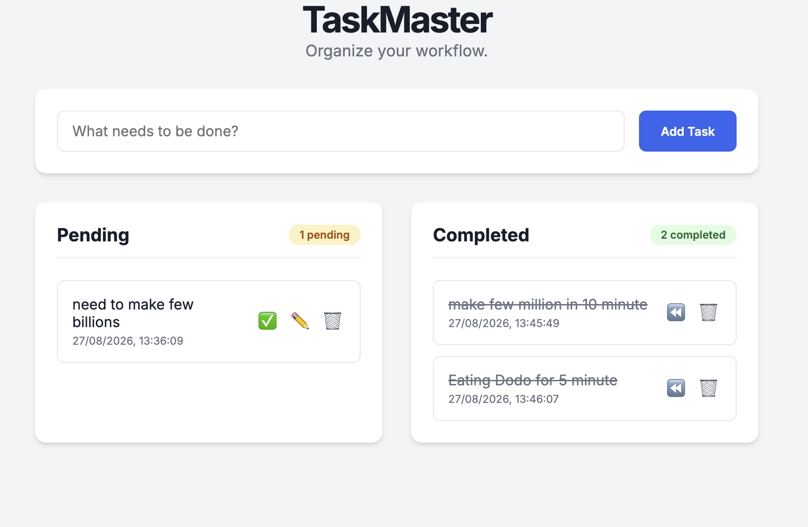

# 📝 TaskMaster: Interactive To-Do Web App

This project is Task 3 of Level 2 in the Web Development and Designing track for the Oasis Infobyte (OIBSIP) Internship. It is a fully interactive task management application designed with a focus on user experience and robust state management.

## 🚀 Live Demo
*([https://oibsip-cyan.vercel.app/WebDev-L2-ToDoApp/index.html])*

## 🛠️ Tech Stack & Architecture
* **HTML5:** Semantic layout with pre-built empty states for optimal accessibility.
* **CSS3:** Modern, responsive UI built with Flexbox and CSS Grid. Includes interactive states and dynamic badges.
* **JavaScript (Vanilla):** Complete CRUD (Create, Read, Update, Delete) functionality with persistent state management.

## ✨ Core Features
* **Persistent Storage:** Tasks are saved to the browser's `localStorage`, ensuring data is never lost across page refreshes.
* **Inline Editing:** Users can edit tasks dynamically within the list without relying on clunky browser prompts.
* **Smart Segmentation:** Automatically separates tasks into "Pending" and "Completed" lists with real-time counter badges.
* **Timestamp Generation:** Automatically logs the exact date and time a task is created.
* **Input Validation & Error Handling:** Prevents users from submitting blank tasks with clean, inline error messaging.

## 📂 File Structure
* `index.html` - The structural markup.
* `style.css` - The design system and responsive layout logic.
* `script.js` - The core application logic, DOM manipulation, and state management.

## 🧠 Developer Notes
The JavaScript architecture mirrors modern component-based frameworks. Instead of manually shifting DOM elements when a task is completed or edited, the application updates a central data array (State) and passes it through an `updateUI()` render function. This ensures the visual interface and the underlying data are always perfectly synchronized.